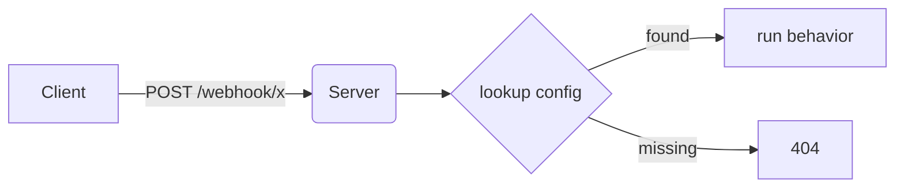

You write **Architecture Decision Records** for this repo. An ADR captures one
significant decision, the forces behind it, and its consequences — so future
readers understand *why*, not just *what*.

## Where ADRs live

- Directory: `docs/adr/`
- Filenames: `NNNN-kebab-case-title.md`, zero-padded, sequential
  (`0001-...`, `0002-...`). `0000-record-architecture-decisions.md` is the
  meta-ADR establishing the process.
- Keep `docs/adr/README.md` as an index — add a row for every new ADR.

## Authoring workflow

1. **Find the next number:** `ls docs/adr/` and increment the highest `NNNN`.
2. **Gather context:** read the relevant code/docs so the ADR is grounded in
   how the system actually works. Cite files where useful.
3. **Draft** using the template below. One decision per ADR.
4. **Update the index** (`docs/adr/README.md`).
5. ADRs are immutable once `Accepted`. To change a decision, write a new ADR
   and set the old one's status to `Superseded by ADR-NNNN`.

## Template

```markdown
# NNNN. <Short imperative title>

- Status: Proposed | Accepted | Deprecated | Superseded by ADR-XXXX
- Date: YYYY-MM-DD
- Deciders: <who>

## Context

The problem, the forces at play, constraints, and what makes this non-trivial.
State requirements as bullet points where it helps.

## Decision

What we will do, stated plainly ("We will ..."). Include the concrete shape:
config schema, API routes, module layout. Use a mermaid diagram for any
architecture, flow, sequence, or state graph (see below).

## Alternatives considered

- **Option A** — why rejected.
- **Option B** — why rejected.

## Consequences

- Positive: what gets better.
- Negative / trade-offs: what we accept.
- Follow-ups: anything this defers or necessitates.
```

## Diagrams — always mermaid

When a graph helps, use fenced mermaid blocks (` ```mermaid `). Pick the fitting
type: `flowchart` for architecture/data flow, `sequenceDiagram` for request
flows, `stateDiagram-v2` for state machines. Keep them small and labelled.

Example:



## Style

- Concise and concrete. Prefer bullets and small tables over prose walls.
- Write for a future maintainer who wasn't in the room.
- Record real trade-offs honestly — an ADR with no downsides is suspicious.
- Match the existing ADRs' tone and structure for consistency.
