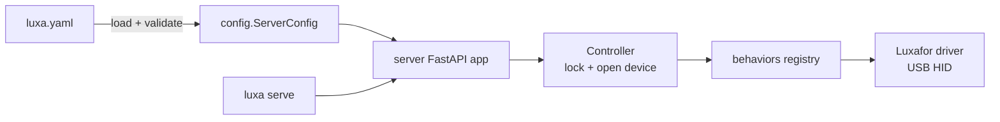
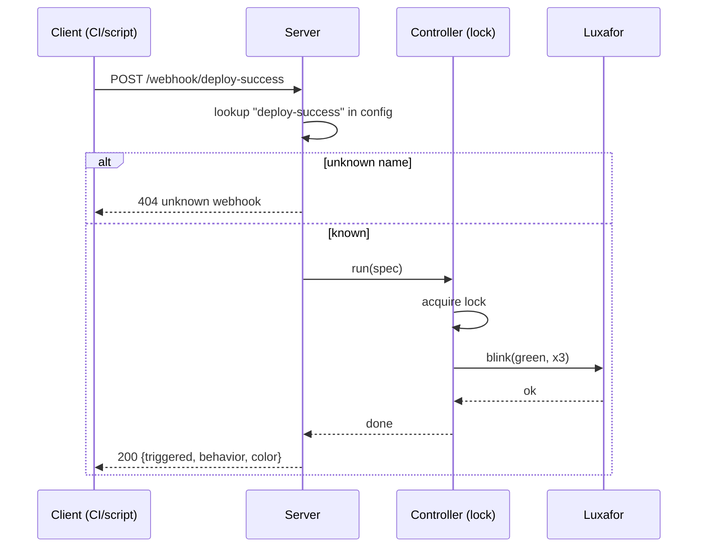
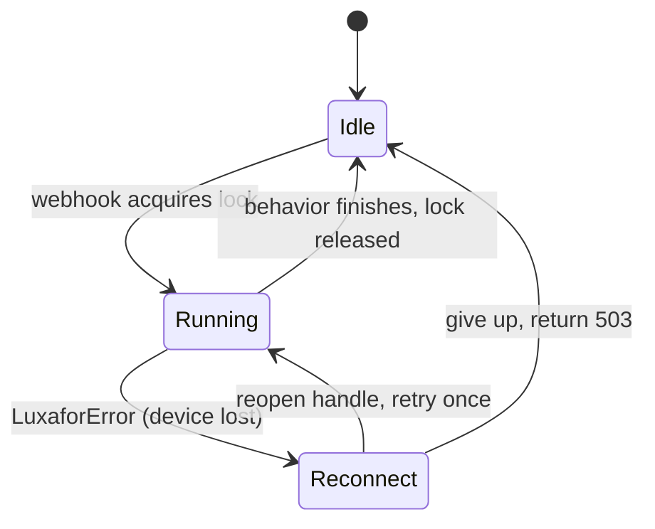

# 0001. YAML-configured webhooks mapped to Luxafor behaviors

- Status: Accepted
- Date: 2026-06-09
- Deciders: project maintainers

## Context

We want external systems (CI, deploy pipelines, alerting, scripts) to drive the
Luxafor Flag by hitting an HTTP endpoint — e.g. "deploy succeeded → blink green",
"build broke → flash red". Requirements:

- Mappings must be **declarative and editable without code** — a config file,
  not Python edits, so non-developers can add/change signals.
- Each webhook maps to a **behavior** (solid, blink, slow/fast blink, flash,
  fade, pulse, off) and a **color** (name or hex), with optional tuning params.
- Run locally as a long-lived process exposing the webhooks over HTTP.
- The single USB device must be accessed safely from concurrent requests.
- Stay aligned with the existing minimal `typer` + `hidapi` codebase.

## Decision

We will add a `luxa serve` command that loads a **YAML config** and runs an HTTP
server. Each entry under `webhooks:` becomes a route `/<method> /webhook/<name>`
that triggers the named behavior on the device.

### Config schema

```yaml
host: 127.0.0.1
port: 8765
webhooks:
  deploy-success:
    behavior: blink
    color: green
    times: 3
  deploy-failed:
    behavior: flash
    color: red
    repeat: 10
  build-running:
    behavior: solid
    color: yellow
  incident:
    behavior: fast_blink
    color: "#ff0033"
  idle:
    behavior: off
```

Validated with **pydantic** (already pulled in by FastAPI): unknown behavior
names and unparseable colors fail fast at load time, not at request time.

### Behaviors

A central registry (`behaviors.py`) maps a behavior name to a device action.
Behaviors layer on top of the existing `Luxafor` driver primitives:

| Behavior     | Driver call            | Default params              |
|--------------|------------------------|-----------------------------|
| `solid`      | `set_color`            | —                           |
| `off`        | `off`                  | —                           |
| `blink`      | `blink` (software)     | times 5, on/off 0.3s        |
| `slow_blink` | `blink`                | times 3, on/off 0.8s        |
| `fast_blink` | `blink`                | times 8, on/off 0.1s        |
| `flash`      | `strobe` (hardware)    | speed 10, repeat 5          |
| `fade`       | `fade`                 | duration 30 ticks           |
| `pulse`      | `wave`                 | wave 1, repeat 3, speed 30  |

Config params (`times`, `on`, `off`, `speed`, `repeat`, `duration`, `wave_type`)
override the defaults per webhook.

### Components



### Request flow



### Concurrency

The Luxafor is a single shared USB handle. The `Controller` opens it once and
serializes every device action behind a `threading.Lock`. FastAPI runs the
synchronous, possibly-blocking handlers (a software blink can take seconds) in
its threadpool, so a slow behavior never blocks the event loop; concurrent
webhooks simply queue on the lock.



## Alternatives considered

- **Static-color HTTP only / no behaviors** — too limiting; the whole point is
  expressive signals (blink vs flash conveys urgency).
- **stdlib `http.server`** — no routing/validation niceties; we'd hand-roll
  request parsing and schema checks. FastAPI gives typed validation, a threadpool
  for blocking work, and `/docs` for free, at the cost of a few dependencies.
- **JSON or TOML config** — YAML reads best for nested human-edited mappings and
  is the common choice for this kind of declarative file.
- **Open the device per request** — simpler but racy under concurrency and adds
  open/close latency to every call; a shared locked handle is cleaner.
- **Behaviors hardcoded in code** — violates the "edit without code" requirement.

## Consequences

- Positive: anyone can wire a new signal by adding a few YAML lines; behaviors
  are reusable and named; validation fails loudly at startup.
- Positive: server is decoupled from the CLI primitives — both share the same
  driver and behavior registry.
- Negative: adds `fastapi`, `uvicorn`, and `pyyaml` (+ transitively `pydantic`)
  to a previously tiny dependency set.
- Negative: single-device serialization means a long behavior delays queued
  webhooks; acceptable for a desk indicator, not a high-throughput service.
- Follow-ups: optional auth/shared-secret on webhooks, a `reload` on SIGHUP, and
  per-webhook "priority/preempt" are deferred to future ADRs if needed.
