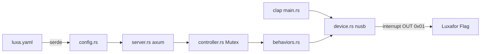

# 0002. Rewrite the project in Rust

- Status: Accepted
- Date: 2026-06-09
- Deciders: project maintainers

## Context

The project began as a Python (Typer + hidapi + FastAPI) CLI and webhook server
(see [ADR 0001](0001-yaml-webhooks-to-luxafor-behaviors.md)). We chose to convert
it to a single Rust binary. Goals:

- Ship one self-contained binary with no runtime interpreter or virtualenv.
- Drop the C `hidapi`/libusb dependency chain (the dev headers weren't even
  present on the target machine).
- Keep behavior parity: same CLI commands, same YAML config, same webhook routes.

## Decision

Reimplement everything in Rust:

| Concern        | Python (before)        | Rust (after)                     |
|----------------|------------------------|----------------------------------|
| CLI            | Typer                  | `clap` (derive)                  |
| USB/HID        | `hidapi` (C, libusb)   | `nusb` (pure Rust, usbfs)        |
| Web server     | FastAPI + uvicorn      | `axum` + `tokio`                 |
| Config + valid.| pydantic + PyYAML      | `serde` + `serde_yaml`           |
| Concurrency    | threadpool + `Lock`    | `spawn_blocking` + `Mutex`       |

### USB approach

`nusb` opens the device via usbfs, detaches the kernel HID driver, claims
interface 0, and writes 8-byte command packets to the interrupt OUT endpoint
(`0x01`). The wire protocol is unchanged from the Python version, so the existing
udev rule and permission model still apply.

## Alternatives considered

- **`hidapi` Rust crate** — a near 1:1 port, but needs `libusb`/`libudev` *dev*
  headers and a C toolchain at build time. `nusb` is pure Rust with zero system
  deps, so the project builds anywhere Cargo runs.
- **`rusb` (libusb bindings)** — same C-dependency problem as hidapi.
- **Keep Python** — rejected per the goals above.

## Consequences

- Positive: a single static-ish binary, no interpreter/venv, no C deps; faster
  startup; `cargo clippy`/`fmt` for quality.
- Positive: behavior parity verified against hardware (flash/blink/color/off and
  all webhook routes).
- Negative: contributors now need a Rust toolchain; the Python files, `pyproject.toml`,
  and `uv.lock` were removed.
- ADR 0001's implementation details (pydantic/FastAPI/threading) are superseded
  here, but its design intent (YAML → behaviors over HTTP) is unchanged.
