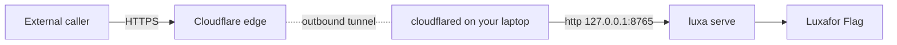

# Exposing the webhook server with cloudflared

`luxa serve` binds to `127.0.0.1:8765` — reachable only from your machine. To let
an external system (a SaaS alerting webhook, a teammate, GitHub Actions) trigger
it, tunnel the port out with [Cloudflare Tunnel](https://developers.cloudflare.com/cloudflare-one/networks/connectors/cloudflare-tunnel/)
(`cloudflared`). The tunnel makes an **outbound** connection to Cloudflare, so
you don't open any inbound ports or touch your router/firewall.



> ⚠️ **Security first.** The luxa webhook server has **no authentication** —
> anyone who can reach the URL can blink your light. A public tunnel makes it
> reachable by the whole internet. Do **not** expose it unprotected. See
> [Protecting it](#protecting-it) below, and prefer a named tunnel + Cloudflare
> Access over a quick tunnel for anything beyond a throwaway test.

## Prerequisites

- `cloudflared` installed (you already have it).
- The server running locally:

  ```bash
  uv run luxa serve        # serving on http://127.0.0.1:8765
  ```

## Option A — Quick tunnel (instant, throwaway)

No account, no config. One command gives you a random
`https://<random>.trycloudflare.com` URL that proxies to your port:

```bash
cloudflared tunnel --url http://127.0.0.1:8765
```

cloudflared prints the public URL. Trigger your webhook through it:

```bash
curl -X POST https://<random>.trycloudflare.com/webhook/incident
```

Characteristics:
- URL changes every run; the tunnel dies when you Ctrl-C.
- **Unauthenticated and world-reachable** — only use for a quick test, and stop
  it when done.

## Option B — Named tunnel (persistent, your own domain)

For a stable URL on a domain you manage in Cloudflare. The `unable to find
config file` message you saw just means no named tunnel is configured yet —
here's the setup.

1. **Authenticate** (opens a browser to pick a zone/domain):

   ```bash
   cloudflared tunnel login
   ```

2. **Create the tunnel** (stores credentials under `~/.cloudflared/`):

   ```bash
   cloudflared tunnel create luxa
   ```

   Note the tunnel UUID it prints.

3. **Write the config** at `~/.cloudflared/config.yml`:

   ```yaml
   tunnel: luxa
   credentials-file: /home/chussenot/.cloudflared/<TUNNEL-UUID>.json

   ingress:
     - hostname: luxa.example.com      # a host on your Cloudflare domain
       service: http://127.0.0.1:8765
     - service: http_status:404        # required catch-all
   ```

4. **Route DNS** to the tunnel (creates the CNAME automatically):

   ```bash
   cloudflared tunnel route dns luxa luxa.example.com
   ```

5. **Run it:**

   ```bash
   cloudflared tunnel run luxa
   ```

   Now `https://luxa.example.com/webhook/incident` reaches your server.

6. **(Optional) run as a service** so it survives reboots:

   ```bash
   sudo cloudflared service install
   sudo systemctl enable --now cloudflared
   ```

## Protecting it

Pick at least one — ideally both:

- **Cloudflare Access (recommended).** With a named tunnel, put the hostname
  behind [Cloudflare Access](https://developers.cloudflare.com/cloudflare-one/policies/access/)
  and create a **service token**. Callers must send the token headers:

  ```bash
  curl -X POST https://luxa.example.com/webhook/incident \
    -H "CF-Access-Client-Id: <id>" \
    -H "CF-Access-Client-Secret: <secret>"
  ```

  Unauthenticated requests are rejected at Cloudflare's edge, before they ever
  reach your laptop.

- **Keep the bind local.** Leave `host: 127.0.0.1` in `luxa.yaml` so the server
  is only reachable through the tunnel, never directly on your LAN.

- **Treat the URL as a secret** for quick tunnels (no Access available) and stop
  the tunnel when you're done.

> luxa itself has no built-in auth or shared-secret check yet — that's tracked as
> a follow-up in [ADR 0001](adr/0001-yaml-webhooks-to-luxafor-behaviors.md).
> Until then, authentication must live at the tunnel/edge.

## Triggering from external systems

Once exposed (and protected), point any webhook source at the public URL, e.g.
a monitoring tool's "incident created" webhook → `POST /webhook/incident`. Most
senders let you add custom headers, which is where the Access service-token
headers go.
